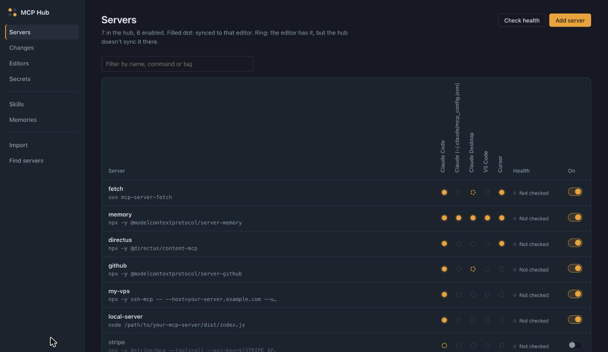
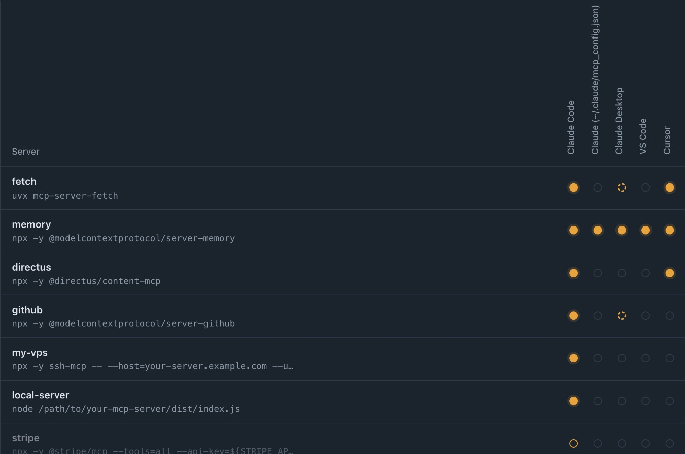
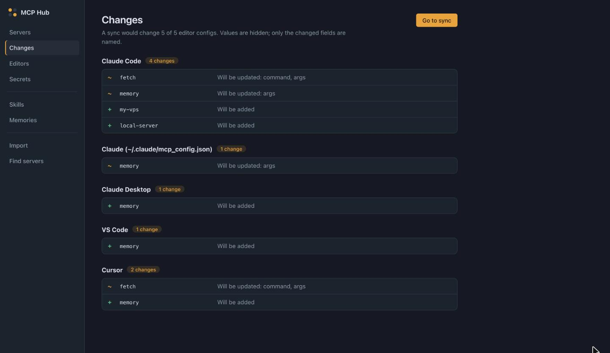
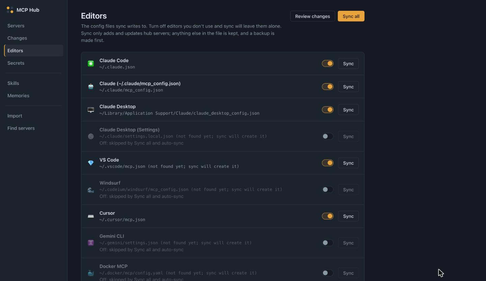
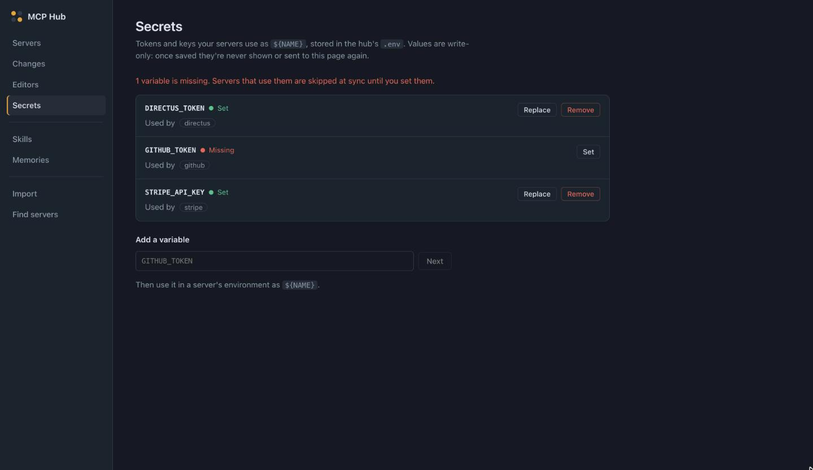
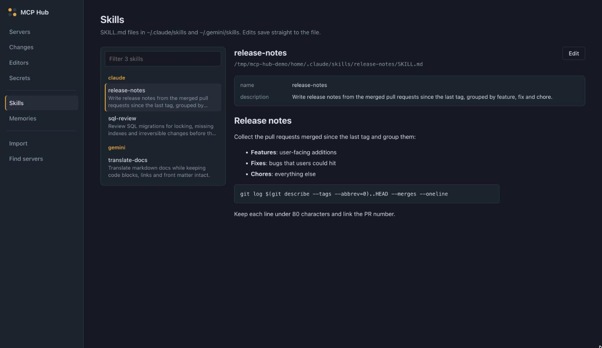
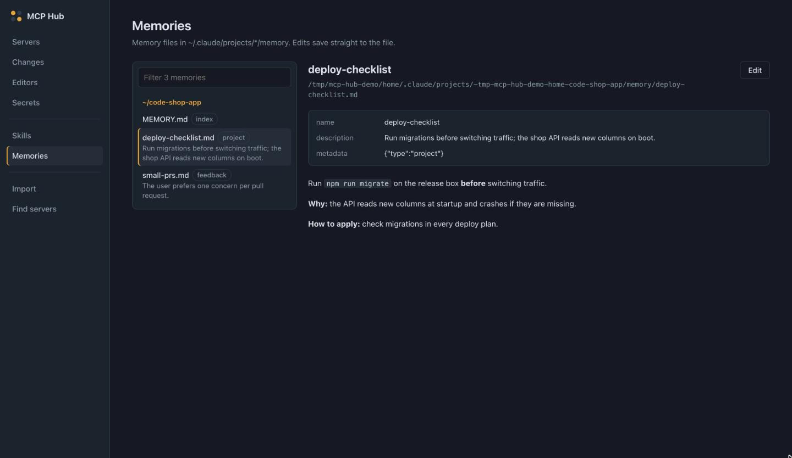
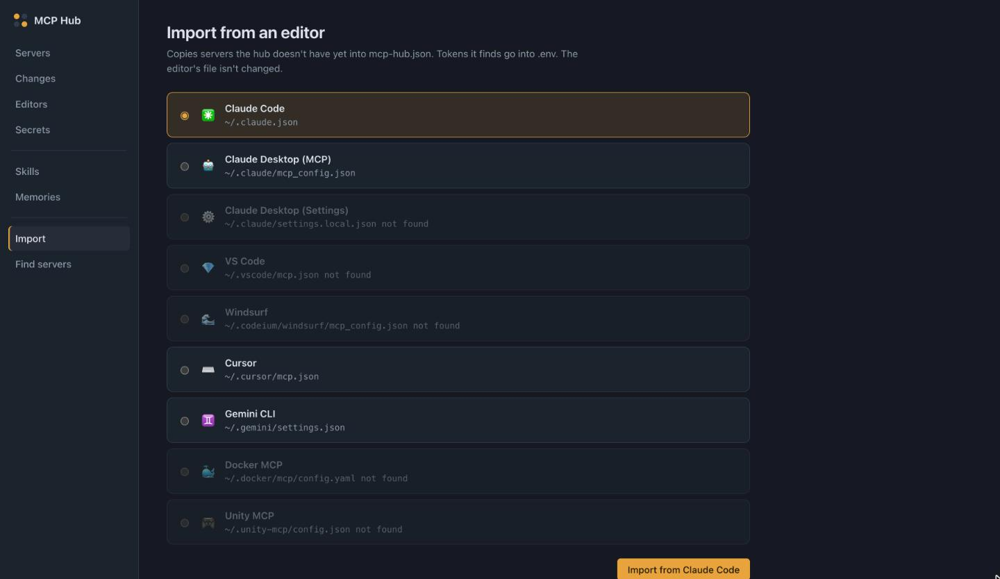
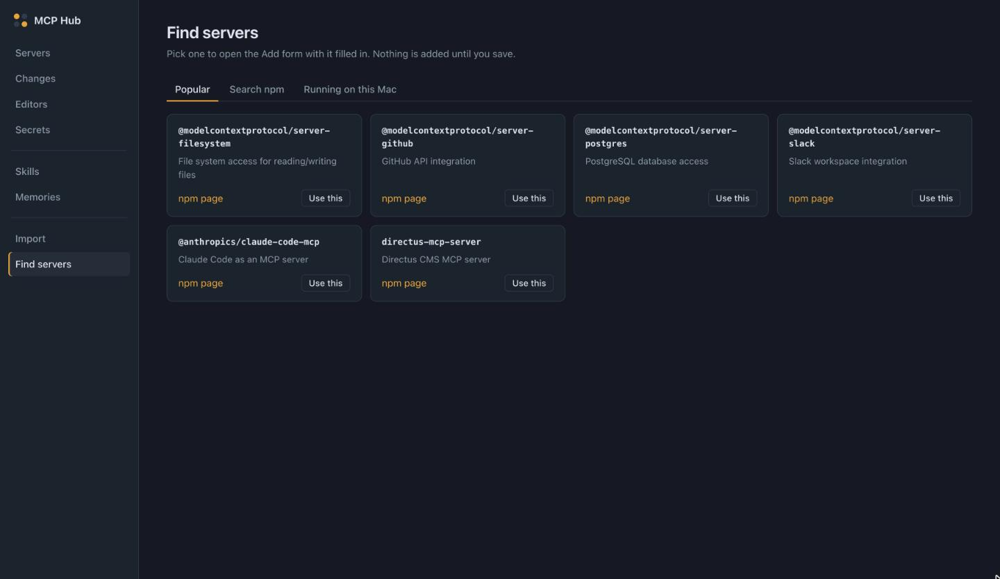

# MCP Hub

One list of MCP servers (`mcp-hub.json`) synced into every editor's config, plus a
dashboard for browsing and editing your skills and memories.



```bash
npm install
cp mcp-hub.example.json mcp-hub.json   # your server list (gitignored)
cp .env.example .env                   # your secrets (gitignored)
npm run dev -- <command>               # or: npm run build && node dist/index.js <command>
```

Already have servers in an editor? `npm run dev -- import --from claude-code` pulls them in
and moves any tokens it finds into `.env`.

Don't use every editor? Turn off the ones you don't use (`targets disable windsurf`, or the
switch on the **Editors** page) and sync leaves their files alone.

## Tests

```bash
npm test                # 345 tests (backend + dashboard)
npm run test:coverage   # same, with coverage; fails below 95% on any metric
```

| Statements | Branches | Functions | Lines |
|---|---|---|---|
| 100% | 100% | 100% | 100% |

Coverage includes the CLI, API server, sync, adapters, health, discovery, deploy and the
dashboard (`web/`, run in jsdom). Tests never touch your real configs:
`tests/setup.ts` points `HOME` and the hub folder at a fresh temp folder before any code
loads, and `tests/isolation.test.ts` fails the run if any path escapes it. SSH, kubectl
and npm are faked; health checks start real `node` processes and a local HTTP server.
The HTML report is written to `coverage/`.

## Commands

| Command | What it does |
|---|---|
| `list [--tag t] [--target ide] [--json]` | Servers in the hub |
| `add <name> …` / `remove` / `enable` / `disable` | Edit the hub |
| `diff [--target ide]` | What a sync would change (field names only, never values) |
| `sync [--target ide] [--dry-run]` | Write hub servers into editor configs |
| `import [--from ide]` | Pull servers from an editor config into the hub. A server already in the hub that turns up in another editor gets that editor added to its `targets` |
| `targets` | List editors: `●` on, `○` off, and whether each config file exists |
| `targets enable <ide>` / `targets disable <ide>` | Turn an editor on or off. Off editors are skipped by `sync`, `diff`, Sync all and auto-sync; their files are left as they are |
| `health [name]` | Start each server and check it answers MCP `initialize` |
| `discover --npm \| --running` | Find MCP servers |
| `skills list \| show <name>` | `~/.claude/skills`, `~/.gemini/skills` |
| `memories list [--project p] \| show <file>` | `~/.claude/projects/*/memory` |
| `serve [--port 3847] [--auto-sync \| --no-watch]` | Web dashboard at http://localhost:3847. Watches `mcp-hub.json` and `.env`: by default it reports what a sync would change and writes nothing; `--auto-sync` syncs on save, only once the config is valid |

## Dashboard

```bash
npm run build              # builds the CLI and the dashboard (web/ → dist/web)
npm run dev -- serve       # http://localhost:3847
```

For working on the dashboard itself, run `npm run dev -- serve` in one terminal and
`npm run dev:web` in another, then open http://localhost:5173 (hot reload; `/api` is
proxied to the hub). It's a Vite + React + TypeScript app in `web/` that shares
`src/types.ts` with the backend; `npm run typecheck:web` checks it.

### Reading the Servers matrix

Each row is a hub server, each column an editor that's switched on (editors you've turned
off on the **Editors** page get no column).



#### The filled dot: "the hub syncs this server to this editor"

A **filled amber dot** means one thing: this editor is in the server's `targets` in
`mcp-hub.json`, so the hub is responsible for this server in this editor's config. It's
a statement about what the hub *will write*, not about what the editor's file contains
right now.

- **Where it comes from:** the server's `targets` list. `"targets": ["claude-code",
  "cursor"]` fills those two columns; `"targets": "*"` fills every column (every editor
  that's switched on). Change it on the server's page (**Edit** → **Sync to**, where
  **Every editor** means `"*"`), with `add --targets`, or by editing `mcp-hub.json`.
- **What sync does with it:** adds the server to that editor's file if it's missing, or
  updates it if the hub's version differs. If they already match, nothing is written.
- **What it doesn't promise:** that the server is in the editor's file yet. Until you
  sync, a filled dot can point at a server the editor doesn't have, or at an older
  version of it. The **Changes** page lists exactly which filled dots are still pending
  (`+` will be added, `~` will be updated).
- **When sync skips it anyway:** a server whose `${VAR}` has no value in `.env` is held
  back and never written with a placeholder (`diff` says `would be skipped — missing in
  .env`). The dot stays filled because the server still targets the editor.

In the screenshots, `memory` targets `"*"`, so it's filled in all five columns. Claude
Code and the Claude config already have it but with older `args`, so the Changes page
shows `~ memory` (update) for them, and `+ memory` (add) for Claude Desktop, VS Code and
Cursor, whose files don't have it yet. `directus` and `github` are filled under Claude
Code but don't appear on the Changes page at all: their tokens aren't set in `.env`, so
sync holds them back.



#### All dot types

| Dot | Meaning | What sync does |
|---|---|---|
| **Filled** (amber) | The hub syncs this server to this editor (see above). | Adds or updates it; skips it while a `.env` var is missing. |
| **Dashed ring** (amber) | The editor's file already has this server, but its `targets` don't include the editor, so the hub doesn't manage it there. | Nothing: it's kept as "unmanaged". To manage it, add the editor to the server's targets (re-running `import` does this too), and the dot becomes filled. |
| **Empty** (grey outline) | Not in the editor's file, and the hub doesn't sync it there. | Nothing. |
| **Solid ring** (amber outline, faded row) | The server is switched off in the hub but targets this editor: it would be a filled dot when on. | Nothing while it's off. |

In the screenshot, `fetch` and `github` show a dashed ring under Claude Desktop: that file
has them, but their `targets` only list Claude Code (and Cursor). Hover a dot for a
tooltip. Matching ignores case and punctuation, so `AbletonMCP` in an editor matches the
hub's `abletonmcp`. Only server names are read from editor configs for this; values never
leave the hub.

### Pages

Screenshots use demo data from `mcp-hub.example.json` (with a few editors switched off and
sample editor configs, so every kind of dot shows).

**Add server** has a paste box: paste an editor's JSON (a whole `mcpServers` block, or a
single `"name": { … }` entry, trailing commas and all). One server fills the form; several
can be added in one go.

| | |
|---|---|
| **Servers**: which server goes to which editor, health, on/off<br> | **Changes**: which filled dots a sync would still add or update, field names only<br> |
| **Editors**: each config file, an on/off switch per editor, sync with a confirm step<br> | **Secrets**: set, replace or remove `.env` tokens, write-only<br> |
| **Skills**: read and edit `SKILL.md` files in place<br> | **Memories**: read and edit memory files by project<br> |
| **Import**: pull servers in from an editor's config<br> | **Find servers**: popular servers, npm search, running processes<br> |

The dashboard listens on `127.0.0.1` only (`--host` to change that, with a warning),
rejects requests for other host names, and refuses changes coming from other websites.

## Targets

`claude-code` (`~/.claude.json`, the file Claude Code reads), `claude-desktop`
(`~/Library/Application Support/Claude/claude_desktop_config.json`, the file Claude Desktop
reads), `claude-mcp` (`~/.claude/mcp_config.json`), `claude-settings`, `vscode`,
`windsurf`, `cursor`, `gemini`, `docker`, `unity`.

A server is synced only to the targets in its `targets` list (`"*"` means every editor
that's on), and only to editors that are switched on. Switched-off editors are stored in
`mcp-hub.json`:

```json
"settings": { "disabledTargets": ["windsurf", "docker", "unity"] }
```

Everything is on by default, so new editors show up on. A typo in this list (or anywhere
else) is caught before an auto-sync writes anything.

## Safety rules (built in)

- **Sync never removes anything.** Servers in an editor's config that the hub doesn't
  manage are kept (`diff` shows them as "unmanaged"). Disabled hub servers are left as-is.
  To remove a server from an editor, edit that editor's config.
- **Secrets live in `.env`** (gitignored), referenced as `${VAR}` in `mcp-hub.json`
  (committed). Sync and health resolve them; a server with a missing var is **skipped**,
  never written with a placeholder. `import` moves detected secrets to `.env` automatically.
  See `.env.example` for the variable names.
- **Sync refuses to run from an empty hub** (e.g. `mcp-hub.json` not found).
- **Editors you turn off are never written**, not even with `sync --target <ide>`; turn
  them back on first. `sync --dry-run --target <ide>` still previews them.
- Every write is preceded by a backup in `~/.mcp-hub/backups` and done atomically.
- Sync only replaces the server list in an editor's file. Every other key (Claude Code's
  state in `~/.claude.json`, `permissions` in Claude settings, Gemini's `ui`…) is kept,
  and a file that can't be parsed is never written. Docker's own per-server
  `config.yaml` (no server list) is left alone.
- `deploy` (SSH or Kubernetes) merges the same way, fills in `${VAR}` values, and skips
  servers with missing vars. Kubernetes gets a **Secret** (not a ConfigMap), sent to
  `kubectl` on stdin; mount it with `volumes[].secret.secretName`.
- **Tokens stay private.** New editor configs, `.env` and backups are created `0600`
  (folders `0700`); existing files keep their permissions; symlinks are written through.
  Secrets are write-only in the dashboard: names and status go out, values never do, and
  the Changes page gets field names only.
- Skills/memories: only existing `.md` files inside those folders can be edited.
- The hub folder defaults to this project; override with `MCP_HUB_HOME`.
- Always run `diff` before `sync`.
